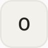

<p align="center">
  
</p>

<h1 align="center">oot</h1>

<p align="center">
  An Android app that shows how much of your AI subscriptions and API credits you have left — per vendor, in a persistent notification.
</p>

<p align="center">
  <a href="https://github.com/parkjangwon/oot/actions/workflows/ci.yml"></a>
  <a href="https://github.com/parkjangwon/oot/releases/latest"></a>
  
</p>

## Screenshots

<table>
  <tr>
    <td align="center"><br><sub>Dashboard (light)</sub></td>
    <td align="center"><br><sub>Dashboard (dark)</sub></td>
    <td align="center"><br><sub>In-app update prompt</sub></td>
  </tr>
  <tr>
    <td align="center" colspan="3"><br><sub>Collapsed notification — one line, in your custom order</sub></td>
  </tr>
  <tr>
    <td align="center" colspan="3"><br><sub>Expanded notification — one line per vendor, in your custom order</sub></td>
  </tr>
</table>

Screenshots use sample data only.

## Features

- **Per-vendor remaining amount**
  - Subscription windows (like 5-hour or weekly limits) are shown as **% left**, together with the window's reset time.
  - API credit balances are shown as an amount (for example **$** or **¥**).
  - The summary line at the top names the limit that is about to run out first.
  - Low items are highlighted at **20% left** and turn red at **5%**.
- **Drag to reorder** — long-press a vendor card and drag it; the order is saved and the notification follows it.
- **Persistent notification**
  - Collapsed: a single line with the first 2–3 vendors in your custom order.
  - Expanded: one line per vendor, showing its 5-hour window when it has one (otherwise its lowest window) and that window's reset time.
  - Every notification also carries a plain-text summary (for example `Claude 62% · OpenRouter $12.40`), so it stays readable on devices that render custom notification layouts poorly.
- **Refresh interval** — 1, 5, 15, 30 or 60 minutes. Short intervals run inside the notification's foreground service and use more battery; vendors that answer HTTP 429 are backed off automatically.
- **In-app update**
  - Checks GitHub Releases on launch, at most once a day (toggle in Settings).
  - Downloads the APK, verifies it is signed with the same key as the installed app, then opens the system installer.
- **Dark theme** — light and dark, following the system.

## Supported vendors

| Vendor | Auth | What oot shows |
| :--- | :--- | :--- |
|  **Claude** | API key or OAuth | 5-hour and weekly usage windows as % left, with reset times |
|  **OpenAI** | ChatGPT sign-in (OAuth) or API key | ChatGPT plan 5-hour and weekly windows as % left, with reset times; with an API key, remaining rate-limit tokens |
|  **xAI (Grok)** | API key or device-code login | Weekly subscription quota as % left, with reset time |
|  **Z.ai (GLM)** | API key | GLM coding plan 5-hour and weekly quota as % left, with reset times |
|  **OpenRouter** | API key | Account credits in $, plus the key's own limit and what is left of it, when the key has one |
|  **DeepSeek** | API key | Remaining balance (USD or CNY) |
|  **Ollama Cloud** | API key | Session and monthly usage as % left, with reset times |
|  **OpenCode Go** | API key | Subscription usage windows as % left, with reset times |
|  **Google Antigravity** | Google sign-in (OAuth) | Google-model and third-party-model quota as % left; the notification shows the Google-model value |

OpenAI and Z.ai are shown with a letter tile because their brand terms do not allow using the logo without permission.

All trademarks and logos are the property of their respective owners and are used only to identify each vendor; this does not imply endorsement. Sources and license notes for every logo: [docs/third-party-logos.md](docs/third-party-logos.md).

## Install

1. Download `oot-vX.Y.Z.apk` from [the latest release](https://github.com/parkjangwon/oot/releases/latest).
2. Open the file. If Android blocks the install, allow installs from unknown sources for the app you opened it with, then try again.

**Important:** v1.1.0 is signed with a new release key. If you have an older oot build installed that was signed with a different key, uninstall it first and add your providers again. Later updates can then be installed in-app.

## Build from source

- JDK 21 and the Android SDK (compileSdk 35 — see `app/build.gradle.kts`).

```bash
./gradlew assembleDebug              # debug build
./gradlew testDebugUnitTest lintDebug  # tests and lint
./gradlew recordRoborazziDebug       # screenshots
```

Release builds are signed in CI and cut from tags: a tag `vX.Y.Z` must match `version` in `gradle.properties`.

## Privacy & security

Tokens and API keys are stored locally in encrypted storage (`EncryptedSharedPreferences`, Android Keystore). The app contains no analytics or telemetry — it only talks to the vendors you add and to GitHub Releases for update checks.

## License

No license has been chosen yet.
