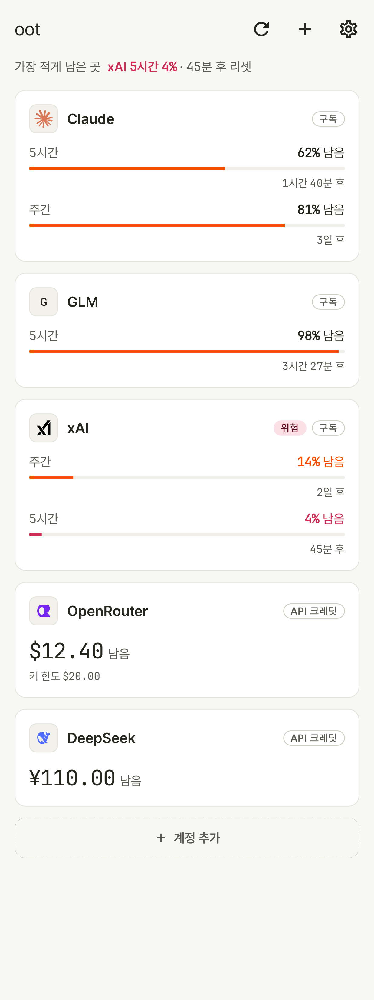
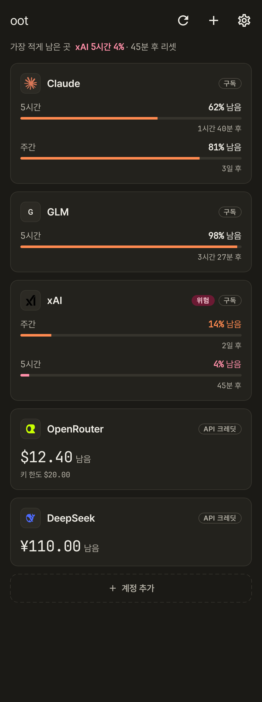
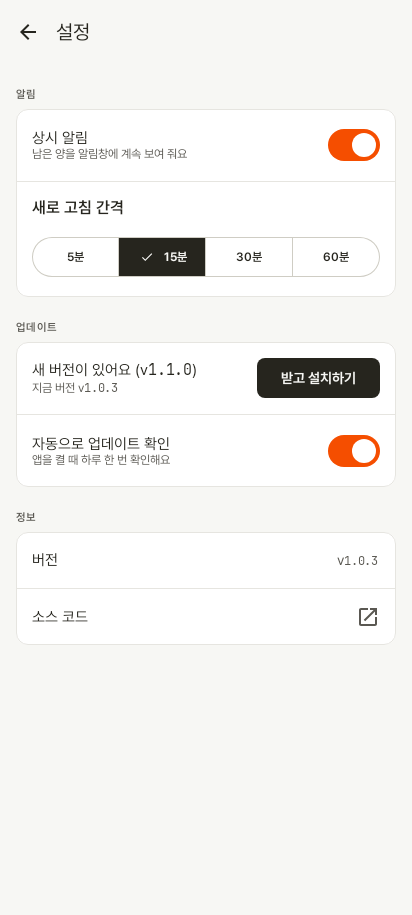
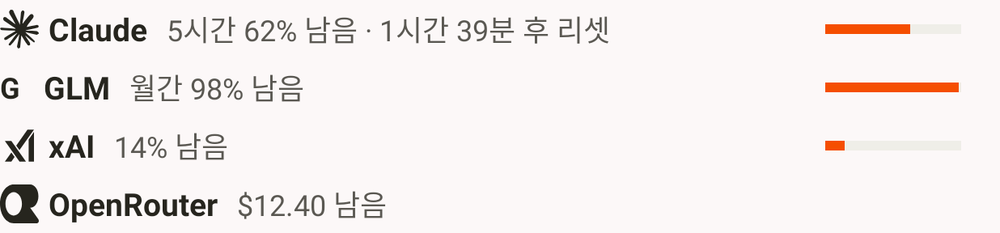

<h1 align="center">oot</h1>

<p align="center">
  An Android app that shows how much of your AI subscriptions and API credits you have left — per vendor, in a persistent notification.
</p>

<p align="center">
  <a href="https://github.com/parkjangwon/oot/actions/workflows/ci.yml"></a>
  <a href="https://github.com/parkjangwon/oot/releases/latest"></a>
  
</p>

## Screenshots

<table>
  <tr>
    <td align="center"><br><sub>Dashboard (light)</sub></td>
    <td align="center"><br><sub>Dashboard (dark)</sub></td>
    <td align="center"><br><sub>In-app update prompt</sub></td>
  </tr>
  <tr>
    <td align="center" colspan="3"><br><sub>Collapsed notification — one line with the lowest items</sub></td>
  </tr>
  <tr>
    <td align="center" colspan="3"><br><sub>Expanded notification — one line per vendor</sub></td>
  </tr>
</table>

Screenshots use sample data only.

## Features

- **Per-vendor remaining amount**
  - Subscription windows (like 5-hour or weekly limits) are shown as **% left**, together with the window's reset time.
  - API credit balances are shown in **$**.
  - The **least-remaining limit is the headline** — the one about to run out first is what you see at a glance.
  - Low items are highlighted at **20% left** and turn red at **5%**.
- **Persistent notification**
  - Collapsed: a single line with the 2–3 lowest items, errored vendors first.
  - Expanded: one line per vendor, showing the lower of its windows and that window's reset time.
  - Every notification also carries a plain-text summary (for example `Claude 62% · OpenRouter $12.40`), so it stays readable on devices that render custom notification layouts poorly.
- **In-app update**
  - Checks GitHub Releases on launch, at most once a day (toggle in Settings).
  - Downloads the APK, verifies it is signed with the same key as the installed app, then opens the system installer.
- **Dark theme** — light and dark, following the system.

## Supported vendors

| Vendor | Auth | What oot shows |
| :--- | :--- | :--- |
| **Claude** | API key or OAuth | 5-hour and weekly usage windows as % left, with reset times |
| **OpenAI** | API key or OAuth | Remaining rate-limit tokens (and remaining requests when reported) |
| **xAI (Grok)** | API key or device-code login | Weekly subscription quota as % left, with reset time |
| **Z.ai (GLM)** | API key | GLM coding plan 5-hour and weekly quota as % left, with reset countdown |
| **OpenRouter** | API key | Remaining credit balance in $, taking the key's own limit into account |
| **Cursor** | OAuth | Remaining fast (on-demand) requests |

## Install

1. Download `oot-vX.Y.Z.apk` from [the latest release](https://github.com/parkjangwon/oot/releases/latest).
2. Open the file. If Android blocks the install, allow installs from unknown sources for the app you opened it with, then try again.

**Important:** v1.1.0 is signed with a new release key. If you have an older oot build installed that was signed with a different key, uninstall it first and add your accounts again. Later updates can then be installed in-app.

## Build from source

- JDK 21 and the Android SDK (compileSdk 35 — see `app/build.gradle.kts`).

```bash
./gradlew assembleDebug              # debug build
./gradlew testDebugUnitTest lintDebug  # tests and lint
./gradlew recordRoborazziDebug       # screenshots
```

Release builds are signed in CI and cut from tags: a tag `vX.Y.Z` must match `version` in `gradle.properties`.

## Privacy & security

Tokens and API keys are stored locally in encrypted storage (`EncryptedSharedPreferences`, Android Keystore). The app contains no analytics or telemetry — it only talks to the vendors you add and to GitHub Releases for update checks.

## License

No license has been chosen yet.

Vendor logos are trademarks of their respective owners. See [docs/third-party-logos.md](docs/third-party-logos.md).
